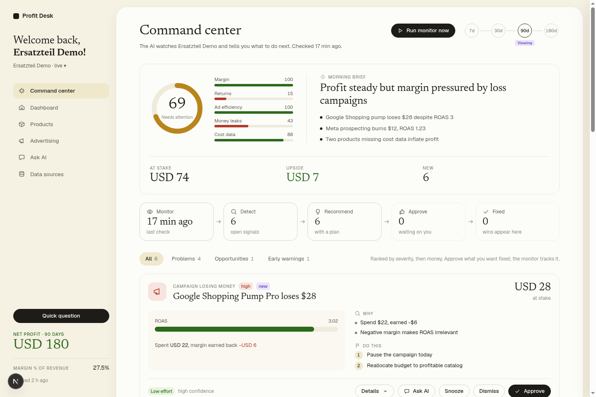
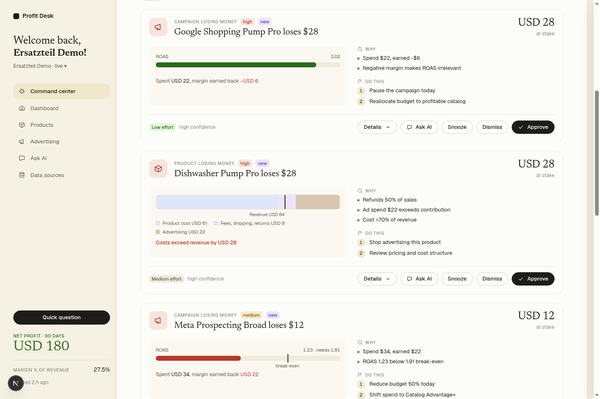
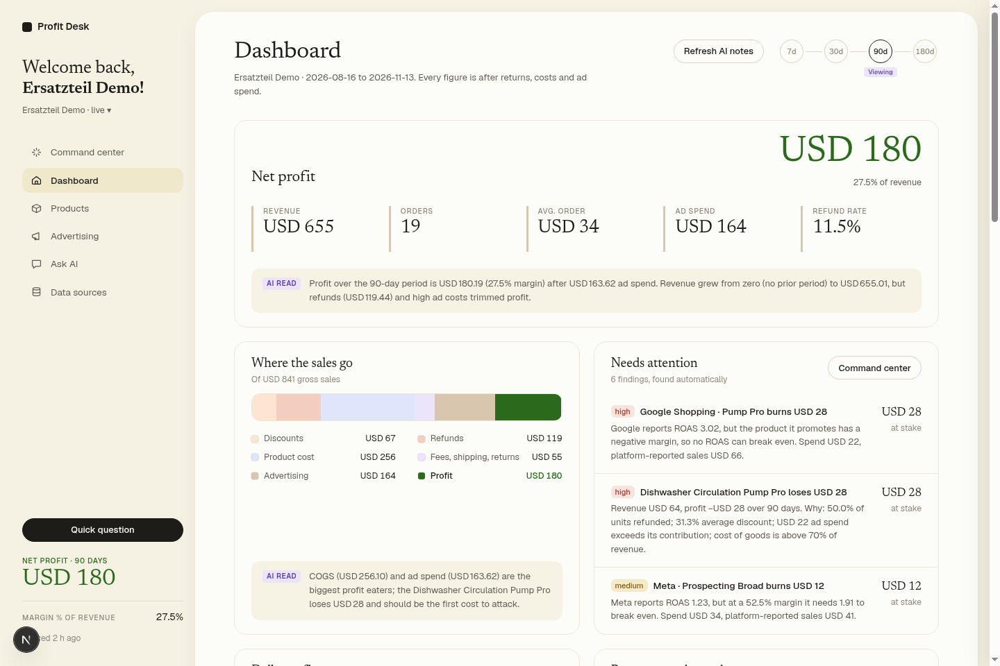
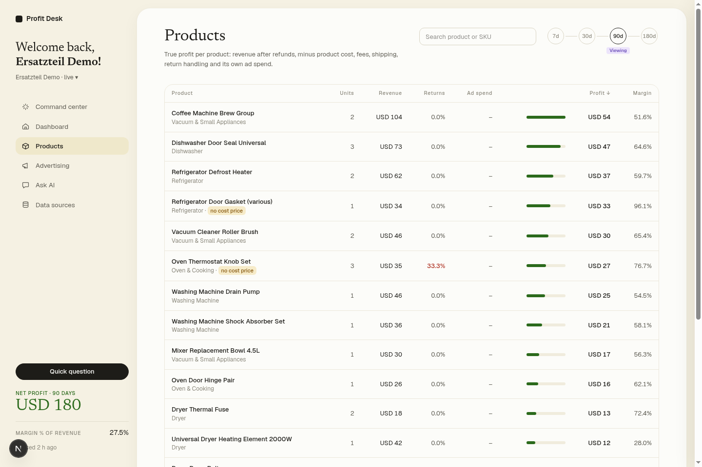
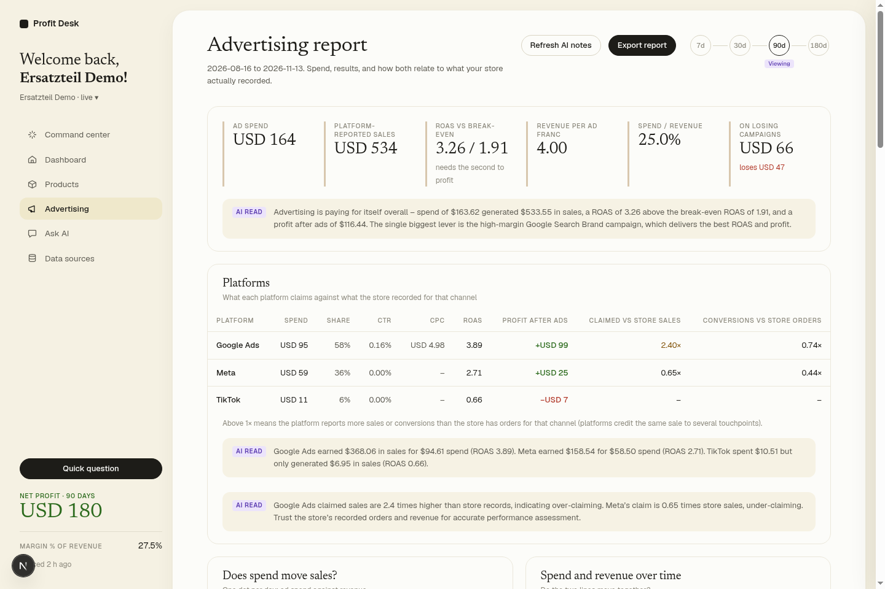
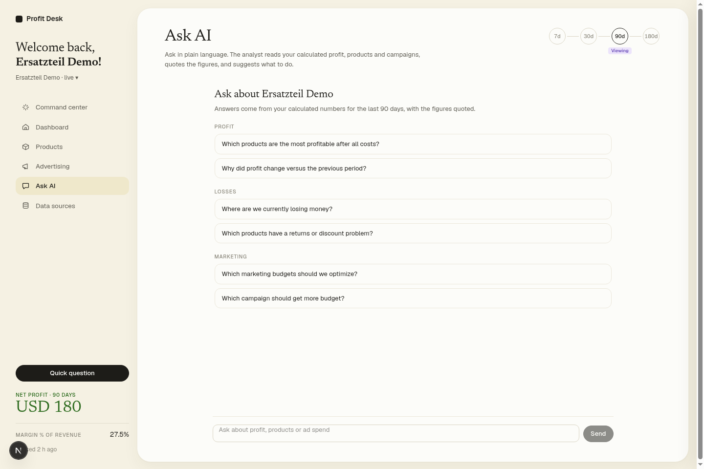
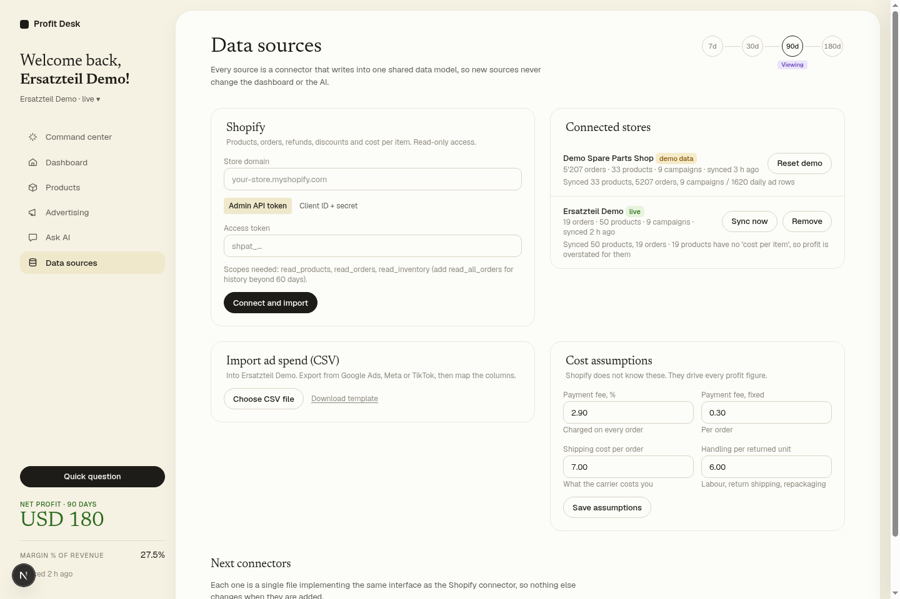

# Profit Desk: Schritt-für-Schritt-Anleitung

Diese Anleitung führt Sie durch die Anwendung, so wie Sie sie im Alltag benutzen. Sie ist keine Entwickler-Dokumentation: Es geht nur darum, **wo Sie klicken und was Sie dabei sehen**.

> **Zur Sprache:** Die Oberfläche und die KI-Texte sind derzeit auf **Englisch**. Die Bezeichnungen von Schaltflächen und Menüpunkten stehen in dieser Anleitung deshalb **fett in Englisch**, danach folgt die deutsche Erklärung. Sie können dem Chat auch auf Deutsch schreiben; die Antworten kommen derzeit meist auf Englisch.

## Inhalt

1. [Worum geht es?](#1-worum-geht-es)
2. [Erste Schritte: Shop und Zeitraum](#2-erste-schritte-shop-und-zeitraum)
3. [Command center: Was soll ich heute tun?](#3-command-center-was-soll-ich-heute-tun)
4. [Dashboard: Der echte Gewinn auf einen Blick](#4-dashboard-der-echte-gewinn-auf-einen-blick)
5. [Products: Welche Artikel lohnen sich wirklich?](#5-products-welche-artikel-lohnen-sich-wirklich)
6. [Advertising: Bringt die Werbung etwas?](#6-advertising-bringt-die-werbung-etwas)
7. [Ask AI: Fragen stellen](#7-ask-ai-fragen-stellen)
8. [Data sources: Daten verbinden und Annahmen anpassen](#8-data-sources-daten-verbinden-und-annahmen-anpassen)
9. [Typische Arbeitsabläufe](#9-typische-arbeitsabläufe)
10. [Kennzahlen einfach erklärt](#10-kennzahlen-einfach-erklärt)
11. [Häufige Fragen und Meldungen](#11-häufige-fragen-und-meldungen)
12. [Was die Anwendung (noch) nicht tut](#12-was-die-anwendung-noch-nicht-tut)

---

## 1. Worum geht es?

Ein Online-Shop zeigt meist den **Umsatz**. Entscheidend ist aber der **Gewinn**. Von jedem Verkauf gehen Rabatte, Retouren, der Einkaufspreis, Zahlungsgebühren, Versand und Werbekosten ab. Und die Werbeplattformen melden ihre eigenen, meist zu guten Zahlen.

Profit Desk bringt diese Daten an einem Ort zusammen und rechnet den **echten Gewinn nach allen Kosten**. Eine KI beobachtet die Zahlen laufend, findet Probleme und Chancen von selbst und sagt Ihnen, was Sie als Nächstes tun sollten.

Der Ablauf, den die Anwendung durchläuft:

```
Beobachten  →  Erkennen  →  Empfehlen  →  Genehmigen  →  Behoben
 (Monitor)     (Signale)    (KI-Karten)    (Ihr Klick)    (Erfolg)
```

---

## 2. Erste Schritte: Shop und Zeitraum

Beim Öffnen der Anwendung ist der **Shopify-Shop** bereits ausgewählt, mit einem Zeitraum von **90 Tagen**.



**So gehen Sie vor:**

1. **Menü links:** Hier wechseln Sie zwischen den Seiten **Command center**, **Dashboard**, **Products**, **Advertising**, **Ask AI** und **Data sources**.
2. **Shop wechseln:** Unter der Begrüssung (**Welcome back, …**) steht der Name des Shops. Dort können Sie bei Bedarf auf den Demo-Shop wechseln (**Demo Spare Parts Shop**, mit sechs Monaten Beispieldaten). In einem neuen Browser-Tab oder nach dem Schliessen des Browsers beginnt die Anwendung wieder beim Shopify-Shop.
3. **Zeitraum wählen:** Oben rechts steht eine Reihe von Kreisen: **7d**, **30d**, **90d**, **180d** (Tage). Klicken Sie auf einen Kreis. Unter dem aktiven Kreis steht **Viewing**. Alle Zahlen im ganzen Programm richten sich nach diesem Zeitraum.
4. **Gewinn im Blick:** Links unten steht immer **Net profit** (Nettogewinn) und **Margin % of revenue** (Marge) für den gewählten Zeitraum.

> Die Beträge erscheinen in der **Währung des Shops** (hier USD, im Demo-Shop CHF).

---

## 3. Command center: Was soll ich heute tun?

Das ist die Startseite und das Herzstück. Sie müssen hier **keine Frage stellen**. Die KI hat die Daten bereits geprüft und zeigt, was Aufmerksamkeit braucht.

### Schritt 1: Gesundheitswert und Tagesbriefing lesen

Ganz oben sehen Sie:

- **Der Ring mit einer Zahl von 0 bis 100:** der Gesundheitswert Ihres Shops (z. B. 69 = **Needs attention**). Daneben stehen die fünf Teilwerte: **Margin** (Marge), **Returns** (Retouren), **Ad efficiency** (Werbeeffizienz), **Money leaks** (Geldverluste) und **Cost data** (Vollständigkeit der Einkaufspreise).
- **Morning brief:** die wichtigste Aussage des Tages in einem Satz, dazu drei Stichpunkte.
- **At stake / Upside / New:** wie viel Geld auf dem Spiel steht, wie viel Potenzial es gibt und wie viele Meldungen neu sind.

### Schritt 2: Die Arbeitsleiste verstehen

Darunter zeigt eine Leiste den **Ablauf mit Zahlen**: **Monitor** (letzte Prüfung) → **Detect** (offene Meldungen) → **Recommend** (Meldungen mit Plan) → **Approve** (von Ihnen genehmigt) → **Fixed** (behoben).

So sehen Sie, wo Ihre Meldungen gerade stehen.

### Schritt 3: Meldungen (Karten) durchgehen

Darunter folgen die Meldungen als **Karten**, sortiert nach Dringlichkeit und Geldbetrag. Mit den Reitern **All**, **Problems**, **Opportunities** und **Early warnings** filtern Sie nach Art.



So ist eine Karte aufgebaut:

| Bereich | Bedeutung |
|---|---|
| **Symbol und Titel** | Was los ist, z. B. «Product losing money» (Artikel macht Verlust) |
| **Rot/Gelb/Grau-Marke** | **high**, **medium**, **low**: wie dringend es ist. **new** heisst: neu seit der letzten Prüfung |
| **Betrag rechts** | **at stake**: so viel Geld steht auf dem Spiel. Bei Chancen steht **upside** |
| **Kleine Grafik links** | Zeigt das Problem sofort, z. B. Kosten gegen Umsatz oder die Werbewirkung gegen die Schwelle |
| **WHY** | Zwei bis drei kurze Gründe, mit Zahlen |
| **DO THIS** | Ein bis drei konkrete Schritte, die Sie heute machen können |
| **Low/Medium/High effort** | Wie viel Aufwand die Umsetzung braucht |
| **… confidence** | Wie sicher sich die KI aufgrund der Daten ist |

### Schritt 4: Auf eine Karte reagieren

Unten in jeder Karte stehen Schaltflächen:

1. **Details:** klappt den ganzen Text zur Meldung auf.
2. **Ask AI:** öffnet den Chat mit einer vorbereiteten Frage zu genau dieser Meldung.
3. **Approve:** Sie genehmigen die Empfehlung. Die Karte wird als **approved · tracking** markiert und in der Arbeitsleiste gezählt.
4. **Snooze:** Sie legen die Meldung zurück. Sie wird abgeblendet. Mit **Unsnooze** holen Sie sie zurück.
5. **Dismiss:** Sie verwerfen die Meldung, wenn sie für Sie nicht stimmt.
6. **Undo approval:** nimmt eine Genehmigung zurück.

> **Wichtig:** **Approve** hält Ihre Entscheidung fest und verfolgt, ob das Problem verschwindet. Die Anwendung ändert dabei **nichts** in Shopify oder in den Werbekonten. Die Massnahme führen Sie selbst aus.

### Schritt 5: Erfolge sehen

Wenn Sie eine Meldung genehmigt haben und die Prüfung das Problem später **nicht mehr findet**, erscheint sie im Bereich **Wins** mit dem Betrag, der gespart wurde.

### Schritt 6: Neu prüfen lassen

Mit **Run monitor now** (oben rechts) prüft die KI alle Daten sofort erneut. Das dauert einige Sekunden. Im normalen Betrieb kann die Prüfung automatisch nach Zeitplan laufen.

### Schritt 7: Budget-Simulator «What if we move budget?»

Weiter unten finden Sie einen Simulator. Er zeigt, was passiert, wenn Sie Werbegeld von Verlust-Kampagnen zu guten Kampagnen verschieben.

1. Schieben Sie den Regler **Cut losing campaigns by** (Verlustkampagnen kürzen um) auf einen Wert, z. B. 60 %.
2. Mit dem Regler **Winners keep this share of their return** legen Sie fest, wie viel der bisherigen Wirkung gute Kampagnen mit mehr Geld behalten (70 % ist eine vorsichtige Annahme).
3. Rechts sehen Sie **projected profit change**: die geschätzte Gewinnänderung.
4. **AI suggestion** stellt die empfohlenen Werte wieder ein.

Das ist eine **Schätzung auf Basis vergangener Margen**, keine Garantie. Gute Kampagnen bekommen höchstens 50 % mehr Budget, damit das Ergebnis realistisch bleibt.

---

## 4. Dashboard: Der echte Gewinn auf einen Blick

Klicken Sie im Menü auf **Dashboard**. Hier finden Sie die Zahlen hinter den Karten.



**So lesen Sie die Seite von oben nach unten:**

1. **Net profit:** der Gewinn nach allen Kosten, gross angezeigt, mit Marge und Vergleich zur Vorperiode.
2. **Kennzahlen darunter:** **Revenue** (Umsatz), **Orders** (Bestellungen), **Avg. order** (durchschnittlicher Warenkorb), **Ad spend** (Werbeausgaben), **Refund rate** (Retourenquote). Pfeile und Prozente zeigen die Veränderung zur Vorperiode.
3. **Where the sales go:** ein Balken, der zeigt, wohin jeder Verkaufsfranken fliesst: Rabatte, Rückerstattungen, Einkaufspreis, Gebühren/Versand/Retouren, Werbung und der Rest als Gewinn. So sehen Sie, welcher Kostenblock sich am meisten lohnt anzugehen.
4. **Needs attention:** die drei dringendsten automatisch gefundenen Probleme.
5. **Daily profit:** Gewinn pro Tag. Fahren Sie mit der Maus über einen Balken, um die Zahlen des Tages zu sehen. Rote Balken sind Verlusttage.
6. **Revenue vs ad spend:** Umsatz und Werbeausgaben pro Tag in einer Grafik.
7. **Revenue by channel / by category:** Umsatz nach Verkaufskanal (z. B. Google, Meta, organisch) und nach Produktkategorie.
8. **Campaign profit after ad cost:** was jede Kampagne nach Abzug der Werbekosten bringt.
9. **Most profitable / Least profitable:** Ihre besten und schwächsten Artikel nach Gewinn.

**Unter jeder Grafik steht ein grauer Kasten «AI read»:** eine kurze Erklärung der KI, was die Grafik zeigt und was zu tun ist. Wenn die KI gerade nicht antwortet, steht dort stattdessen **Summary** mit einer rein berechneten Aussage. Mit **Refresh AI notes** (oben) lassen Sie die Texte neu schreiben.

---

## 5. Products: Welche Artikel lohnen sich wirklich?

Klicken Sie auf **Products**.



1. **Tabelle lesen:** Jede Zeile ist ein Artikel mit **Units** (verkaufte Stück), **Revenue**, **Returns** (Retourenquote), **Ad spend**, **Profit** und **Margin**. Der kleine Balken bei **Profit** zeigt grün Gewinn und rot Verlust.
2. **Sortieren:** Klicken Sie auf eine Spaltenüberschrift. Ein zweiter Klick dreht die Reihenfolge um. Der Pfeil zeigt die Richtung.
3. **Suchen:** Oben rechts im Feld **Search product or SKU** tippen Sie einen Namen oder eine Artikelnummer.
4. **Details öffnen:** Klicken Sie auf eine Zeile. Es klappt die **Kostenaufstellung** auf: Umsatz nach Rabatt, Rückerstattungen, Einkaufspreis, Zahlungsgebühren, Versand, Retourenaufwand und eigene Werbekosten, bis zum Gewinn.
5. **Gelbe Marke «no cost price»:** Für diesen Artikel fehlt der Einkaufspreis. Der Gewinn ist dann **zu hoch** ausgewiesen. Tragen Sie in Shopify unter dem Artikel (Variante) das Feld **Cost per item** ein und synchronisieren Sie neu.

---

## 6. Advertising: Bringt die Werbung etwas?

Klicken Sie auf **Advertising**. Das ist ein vollständiger Werbebericht.



### Schritt 1: Die Kennzahlen lesen

Oben stehen **Ad spend** (Ausgaben), **Platform-reported sales** (von den Plattformen gemeldeter Umsatz), **ROAS vs break-even** (Werbewirkung gegen die Mindestschwelle), **Revenue per ad franc** (Umsatz pro Werbefranken), **Spend / revenue** (Anteil der Werbung am Umsatz) und **On losing campaigns** (Geld in Verlust-Kampagnen).

### Schritt 2: Plattformen vergleichen

Die Tabelle **Platforms** zeigt je Plattform (Google, Meta, TikTok) die Ausgaben, die Werbewirkung und den Gewinn nach Werbekosten.

Besonders wichtig sind die letzten beiden Spalten **Claimed vs store sales** und **Conversions vs store orders**: Sie vergleichen, was die Plattform **behauptet**, mit dem, was Ihr **Shop wirklich verbucht** hat. Werte **über 1×** heissen: Die Plattform meldet mehr, als im Shop ankam. Trauen Sie solchen Zahlen nicht allein.

### Schritt 3: Prüfen, ob mehr Werbung mehr Umsatz bringt

- **Does spend move sales?** Jeder Punkt ist ein Tag: Werbeausgaben (waagrecht) gegen Umsatz (senkrecht). Eine ansteigende Punktwolke spricht für einen Zusammenhang, eine flache für keinen.
- **Correlation with your store data:** Die Tabelle gibt für jede Beziehung zwei Werte an:
  - **r raw:** der Zusammenhang, wie er auf den ersten Blick aussieht.
  - **r adjusted:** derselbe Wert, nachdem der gemeinsame Wochenrhythmus (Montag bis Sonntag) herausgerechnet wurde. **Dieser Wert zählt.**
  - **Evidence:** eine Einstufung von **none** (kein Beleg) bis **strong** (stark).

> **Merke:** Eine Korrelation zeigt einen **Zusammenhang**, keinen Beweis, dass die Werbung den Umsatz **verursacht** hat. Steht dort **none**, lässt sich in diesen Daten nicht belegen, dass mehr Werbegeld mehr Umsatz bringt.

### Schritt 4: Kampagnen bewerten

- **Campaign profit after ad cost:** Balken nach rechts (grün) = Gewinn, nach links (rot) = Verlust.
- **All campaigns:** die ganze Liste mit **ROAS**, der nötigen Schwelle (**Needs**), dem Verlauf der Wirkung (**ROAS 1st → 2nd half**) und einer Einstufung: **Scale up** (mehr Budget), **Holding** (so lassen), **Losing money** (Verlust).

### Schritt 5: Bericht exportieren

1. Klicken Sie oben auf **Export report**.
2. Wählen Sie **Excel workbook** (alle Tabellen in einer Datei, mit den KI-Texten) oder eine **CSV**-Datei (**campaigns**, **platforms**, **daily**, **correlations**).
3. **Print or save as PDF** öffnet die Druckansicht, in der Sie auch ein PDF speichern können.

### Schritt 6: Der Werbe-Chat

Ganz unten steht **Ask about your advertising**: ein Chat nur für Werbefragen. Klicken Sie eine Startfrage an, z. B. **Is ad spend actually driving sales, or is it a coincidence?** (Bringt die Werbung wirklich Umsatz oder ist es Zufall?).

---

## 7. Ask AI: Fragen stellen

Klicken Sie im Menü auf **Ask AI**. Alternativ öffnet die Schaltfläche **Quick question** (links unten) denselben Chat als Fenster von der Seite, auf jeder Seite.



**So gehen Sie vor:**

1. **Startfrage anklicken**, z. B.:
   - **Which products are the most profitable after all costs?** (Welche Artikel sind nach allen Kosten am profitabelsten?)
   - **Where are we currently losing money?** (Wo verlieren wir aktuell Geld?)
   - **Which marketing budgets should we optimize?** (Welche Werbebudgets sollten wir optimieren?)
2. **Oder eigene Frage tippen** und mit **Enter** oder **Send** absenden. Mit **Shift + Enter** machen Sie einen Zeilenumbruch.
3. **Antwort lesen:** Die Antwort beginnt mit der Kernaussage, danach folgen Belege (oft als kleine Tabelle) und ein nächster Schritt.
4. **Folgefragen:** Unter der Antwort stehen drei Vorschläge. Ein Klick stellt die Frage.
5. **Unter jeder Antwort:** **Copy** (kopieren), **Regenerate** (neu erzeugen), und rechts steht, welcher KI-Dienst geantwortet hat.
6. **Clear** (neben **Send**) löscht das Gespräch. Das Gespräch bleibt in Ihrem Browser gespeichert, bis Sie es löschen.

**Tipps für gute Fragen:**

- Fragen Sie konkret: «Warum verliert die Kampagne X Geld?» statt «Wie läuft es?».
- Der Zeitraum oben rechts gilt auch für den Chat.
- Die KI antwortet **nur aus den berechneten Zahlen**. Wenn etwas fehlt (z. B. Daten einer nicht verbundenen Plattform), sagt sie das, statt zu raten.

---

## 8. Data sources: Daten verbinden und Annahmen anpassen

Klicken Sie auf **Data sources**.



> **In der öffentlichen Demo** ist diese Seite **schreibgeschützt**. Oben steht ein Hinweis, und die Eingabefelder sind gesperrt. Die folgenden Schritte gelten für eine eigene Installation.

### Schritt 1: Shopify verbinden

1. Tragen Sie bei **Store domain** die Shop-Adresse ein, z. B. `ihr-shop.myshopify.com`.
2. Wählen Sie den Reiter **Admin API token** (Zugriffstoken) oder **Client ID + secret** (Client-ID und Geheimnis der Shopify-App).
3. Tragen Sie die Zugangsdaten ein.
4. Klicken Sie auf **Connect and import**. Die Anwendung verbindet sich und lädt 90 Tage Bestellungen, Produkte, Rückerstattungen und Einkaufspreise.

Die Shopify-App braucht Leserechte für Produkte, Bestellungen und Lagerbestand (**read_products**, **read_orders**, **read_inventory**).

### Schritt 2: Werbeausgaben importieren (CSV)

Bis die direkten Anbindungen an Google, Meta und TikTok bestehen, kommen die Werbedaten als Datei.

1. Klicken Sie bei **Import ad spend (CSV)** auf **Download template** und füllen Sie die Vorlage mit den Exporten aus Ihren Werbekonten.
2. Klicken Sie auf **Choose CSV file** und wählen Sie die Datei aus.
3. Nach dem Import erscheint eine Bestätigung, und die Seite **Advertising** füllt sich.

### Schritt 3: Kostenannahmen anpassen

Shopify kennt einige Kosten nicht pro Bestellung. Sie stehen unter **Cost assumptions** und bestimmen jede Gewinnzahl:

| Feld | Bedeutung |
|---|---|
| **Payment fee, %** und **fixed** | Zahlungsgebühr in Prozent plus fester Betrag pro Bestellung |
| **Shipping cost per order** | Was der Versand Sie pro Bestellung kostet |
| **Handling per returned unit** | Aufwand pro zurückgeschicktem Stück (Arbeit, Rückversand, Verpacken) |

Ändern Sie die Werte und klicken Sie auf **Save assumptions**. Alle Zahlen werden damit neu berechnet.

### Schritt 4: Shop neu laden oder entfernen

Unter **Connected stores** sehen Sie jeden Shop mit Anzahl Bestellungen, Produkten und Kampagnen sowie dem Zeitpunkt der letzten Synchronisierung.

- **Sync now:** lädt die neuesten Daten aus Shopify.
- **Remove:** entfernt den Shop aus der Anwendung (nach einer Rückfrage mit **Yes, remove**). Es wird nur die **lokale Kopie** gelöscht, in Shopify ändert sich nichts.

Unten unter **Next connectors** stehen die geplanten Anbindungen: Google Ads, Meta Ads, TikTok Ads, Google Merchant Center und Google Analytics 4.

---

## 9. Typische Arbeitsabläufe

### A. Wöchentliche Kontrolle (ca. 10 Minuten)

1. Öffnen Sie das **Command center**, wählen Sie **7d** oder **30d** und klicken Sie auf **Run monitor now**.
2. Lesen Sie das **Morning brief** und den Gesundheitswert.
3. Gehen Sie die Karten von oben nach unten durch. Genehmigen (**Approve**) Sie, was Sie umsetzen wollen. Verwerfen (**Dismiss**) Sie, was nicht stimmt.
4. Prüfen Sie unter **Wins**, welche früheren Probleme behoben sind.

**Nutzen:** Sie sehen in Minuten, wo Geld verloren geht, ohne Berichte zusammenzusuchen.

### B. Einen Verlustbringer beheben

1. Auf einer Karte steht z. B. «Product losing money». Klicken Sie auf **Details** und lesen Sie **WHY**.
2. Öffnen Sie auf **Products** den Artikel und klappen Sie die Kostenaufstellung auf: Wo geht das Geld verloren (Rabatt, Retouren, Werbung)?
3. Setzen Sie die Schritte aus **DO THIS** um, z. B. Preis anpassen, Rabatt senken, Werbung pausieren.
4. Klicken Sie auf der Karte auf **Approve**.
5. Prüfen Sie später mit **Run monitor now**: Ist das Problem weg, erscheint ein Eintrag unter **Wins**.

### C. Werbebudget prüfen und umverteilen

1. Öffnen Sie **Advertising**. Sehen Sie in **Platforms**, ob eine Plattform mehr meldet, als der Shop verbucht (**Claimed vs store sales** über 1×).
2. Prüfen Sie in **Campaign profit after ad cost**, welche Kampagnen im Minus liegen.
3. Wechseln Sie zum **Command center** und probieren Sie im Simulator **What if we move budget?**, wie viel das Verschieben bringen würde.
4. Ändern Sie die Budgets in Ihren Werbekonten.
5. Exportieren Sie den Bericht mit **Export report** für Ihr Team oder die Agentur.

### D. Gewinnzahlen verlässlicher machen

1. Achten Sie im **Command center** auf die Meldung «products missing cost data».
2. Tragen Sie in Shopify bei den genannten Artikeln **Cost per item** ein.
3. Klicken Sie unter **Data sources** auf **Sync now**.
4. Prüfen Sie unter **Cost assumptions**, ob Gebühren, Versand und Retouren zu Ihrer Realität passen.

### E. Eine Frage klären

1. Öffnen Sie **Ask AI** und stellen Sie Ihre Frage.
2. Nutzen Sie die Folgefragen, um tiefer zu gehen.
3. Haben Sie einen Verdacht zu einer Kampagne, fragen Sie im Chat unten auf der Seite **Advertising**.

---

## 10. Kennzahlen einfach erklärt

| Begriff | Bedeutung |
|---|---|
| **Net profit** (Nettogewinn) | Was nach **allen** Kosten übrig bleibt: Umsatz nach Rabatten und Retouren, minus Einkaufspreis, Zahlungsgebühren, Versand, Retourenaufwand und Werbung |
| **Margin** (Marge) | Gewinn in Prozent vom Umsatz |
| **Revenue** (Umsatz) | Verkäufe nach Rabatten und Rückerstattungen, ohne Steuern und Versandgebühren |
| **Refund rate** (Retourenquote) | Anteil der Stücke, die zurückerstattet wurden |
| **ROAS** | «Return on ad spend»: Umsatz, den eine Plattform meldet, geteilt durch die Werbeausgaben. 3,0 heisst: 3 Franken gemeldeter Umsatz pro Franken Werbung |
| **Break-even ROAS** («Needs») | Der ROAS, den eine Kampagne **mindestens** braucht, damit sich nach Einkaufspreis und Kosten kein Verlust ergibt. Liegt der ROAS darunter, verliert die Kampagne Geld, auch wenn die Plattform ihn schön findet |
| **Revenue per ad franc** (MER) | Gesamter Shop-Umsatz geteilt durch alle Werbeausgaben. Unabhängig von den Plattform-Meldungen |
| **CPC** | Kosten pro Klick |
| **CTR** | Anteil der Anzeigen, die angeklickt wurden |
| **At stake / Upside** | Geld, das durch ein Problem verloren geht, bzw. Gewinn, der durch eine Chance möglich wäre, im gewählten Zeitraum |
| **Correlation r** | Zahl von −1 bis +1, die zeigt, ob zwei Reihen gemeinsam steigen und fallen. Nahe 0 = kein Zusammenhang. Zeigt keine Ursache |
| **Health score** | Gesamtbewertung 0 bis 100 aus Marge, Retouren, Werbeeffizienz, Geldverlusten und Datenvollständigkeit |

---

## 11. Häufige Fragen und Meldungen

**Die Seite lädt sehr lange oder zeigt «Cannot reach the backend».**
In der öffentlichen Demo schläft der Server nach etwa 15 Minuten ohne Besucher. Der erste Aufruf danach dauert 30 bis 60 Sekunden. Warten Sie kurz und laden Sie die Seite neu.

**Die KI antwortet nicht oder meldet «All AI providers failed … rate limit».**
Der kostenlose KI-Dienst erlaubt nur eine bestimmte Menge pro Minute. Warten Sie etwa eine Minute und versuchen Sie es erneut. Bereits gespeicherte KI-Notizen unter den Grafiken sind davon nicht betroffen.

**Unter einer Grafik steht «Summary» statt «AI read».**
Die KI war nicht erreichbar, deshalb steht dort ein rein berechneter Satz. Mit **Refresh AI notes** versuchen Sie es später noch einmal.

**Der Gewinn ist negativ oder sehr klein.**
Prüfen Sie zuerst, ob genug Bestellungen im gewählten Zeitraum liegen. Wenige Bestellungen und hohe Werbeausgaben ergeben schnell ein Minus. Wählen Sie oben rechts einen längeren Zeitraum.

**Ein Artikel zeigt einen Gewinn, der zu gut aussieht.**
Suchen Sie die gelbe Marke **no cost price** auf der Seite **Products**. Ohne Einkaufspreis ist der Gewinn zu hoch.

**Ich habe «Approve» geklickt, aber im Shop hat sich nichts geändert.**
Das ist richtig. **Approve** hält die Entscheidung fest und verfolgt das Ergebnis. Die Massnahme führen Sie selbst in Shopify oder im Werbekonto aus.

**Die Zahlen weichen von denen der Werbeplattform ab.**
Das ist gewollt. Die Plattformen melden eigene, meist höhere Zahlen. Hier zählt, was der Shop wirklich verbucht hat (siehe **Claimed vs store sales** unter **Advertising**).

**Was bedeutet «new» auf einer Karte?**
Die Meldung wurde bei der letzten Prüfung zum ersten Mal gefunden.

---

## 12. Was die Anwendung (noch) nicht tut

- **Keine automatischen Änderungen:** Preise, Rabatte und Werbebudgets werden nicht automatisch angepasst. **Approve** verfolgt nur.
- **Google Ads, Meta und TikTok per Datei:** Die direkten Verbindungen sind noch nicht gebaut, die Werbedaten kommen per CSV.
- **Geschätzte Kosten:** Zahlungsgebühren, Versand und Retourenaufwand beruhen auf den Annahmen unter **Cost assumptions**.
- **Sprache:** Oberfläche und KI-Texte sind derzeit englisch.
- **Kein Benutzer-Login** in dieser Version.

Geplante nächste Schritte: direkte Anbindung von Google Ads, Meta und TikTok, Google Analytics, die Prüfung nach festem Zeitplan und das Ausführen genehmigter Massnahmen direkt in Shopify, mit Rückgängig-Funktion und Protokoll.
